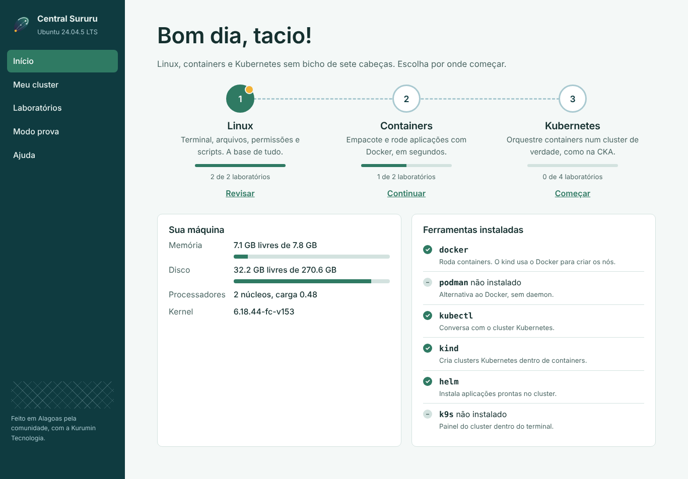

<p align="center">
  
</p>

<h3 align="center">Linux, containers e Kubernetes sem bicho de sete cabeças.</h3>

<p align="center">
  Distribuição brasileira baseada no Debian 13, feita para quem quer aprender infraestrutura moderna.<br>
  Grave no pendrive, dê boot e tenha um cluster Kubernetes com laboratórios guiados em português.
</p>

<p align="center">
  <a href="https://sururu.kurumintecnologia.com.br/docs/">Documentação</a> ·
  <a href="https://github.com/kurumintecnologia/sururu-linux/releases">Baixar a ISO</a> ·
  <a href="docs/contribuir.md">Contribuir</a> ·
  <a href="docs/apoiar.md">Apoiar</a>
</p>



## O que tem de diferente

- **Central Sururu**: painel em português que cria o cluster com um clique,
  mostra nós e pods, traz laboratórios que **se corrigem sozinhos** e um
  **modo prova** com cronômetro no estilo da CKA.
- **Tudo pronto**: `kubectl`, `kind`, `helm`, `k9s`, `docker`, `podman`.
- **Leve e familiar**: XFCE com barra embaixo, roda em notebook de 4 GB.
- **Feito para ensinar**: histórias do cotidiano brasileiro, funciona offline,
  igual para a turma inteira.
- **Base sólida**: pacotes e segurança direto do Debian, Secure Boot,
  ISO assinada com Sigstore, SBOM e varredura de vulnerabilidades a cada versão.

## Gerar a ISO

Num Debian 13:

```bash
make deps
make build    # 20 a 40 minutos
make test     # boota a ISO no QEMU
```

Só quer mexer na Central? `make central` roda ela aqui mesmo, sem ISO.

## Estrutura

```
artwork/        logo, paleta e papéis de parede (gerados por script)
central/        a Central Sururu: Python puro + HTML/JS, sem dependências
  labs/         um laboratório = um arquivo JSON
packaging/      atalhos, padrões do XFCE, tela de login
config/         configuração do live-build (pacotes e hooks)
docs/           documentação (MkDocs)
scripts/        teste de boot e validação dos labs
.github/        CI: ISO, documentação, validação e Renovate
```

## Roadmap

- [x] ISO live com XFCE, ferramentas cloud native e identidade visual
- [x] Central Sururu: cluster, laboratórios e modo prova
- [ ] Instalador Calamares com a marca e os slides do Sururu
- [x] Tela de boot (Plymouth) e tema do menu de boot (GRUB e isolinux)
- [ ] Repositório APT próprio para os pacotes `sururu-*`
- [ ] Trilha de laboratórios para LFCS e CKA completas
- [ ] Laboratórios de observabilidade (Prometheus e Grafana) e GitOps (Argo CD)
- [ ] **2027.1**: lançamento

## Licença

Código e configurações sob [GPL-3.0](LICENSE). Cada pacote do Debian mantém a
própria licença. O Sururu é baseado no Debian, mas não é um produto oficial do
Projeto Debian.

<p align="center"><sub>Feito em Alagoas pela comunidade, com a <a href="https://kurumintecnologia.com.br/">Kurumin Tecnologia</a>.</sub></p>
