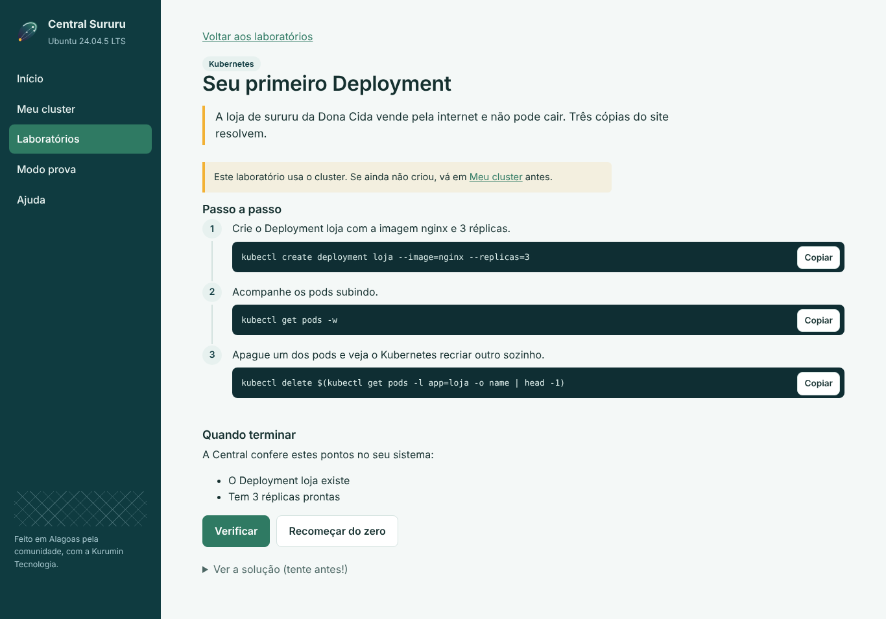

# Como funcionam os laboratórios

Cada laboratório é uma tarefa curta, com uma historinha do dia a dia, passo a
passo e correção automática.

1. **Leia a história.** Ela dá o contexto: a bodega do Seu Zé, a pousada em
   Maragogi, a loja de sururu da Dona Cida.
2. **Faça no terminal.** Cada passo tem o comando e um botão **Copiar**.
   Tente entender o que cada parte faz antes de colar.
3. **Clique em Verificar.** A Central confere o seu sistema de verdade (a
   pasta existe? o pod está rodando?) e mostra o que passou e o que falta,
   com uma dica para cada erro.
4. **Travou?** A solução está escondida no fim da página. Tente antes!

Seu progresso fica salvo em `~/.local/share/sururu/progresso.json` e aparece
na tela inicial, trilha por trilha.

## As trilhas

| Trilha | O que você aprende | Precisa de |
|---|---|---|
| Linux | Terminal, arquivos, permissões, scripts | Nada |
| Containers | Rodar e construir imagens com Docker | Docker |
| Kubernetes | Deployments, Services, ConfigMaps, rollouts | O cluster |

## Modo prova

Quatro tarefas de Kubernetes, 30 minutos no relógio, **sem os comandos
prontos**. Você pode consultar a
[documentação oficial](https://kubernetes.io/pt-br/docs/home/), como na CKA. No
fim, a Central corrige tudo e dá sua nota.
