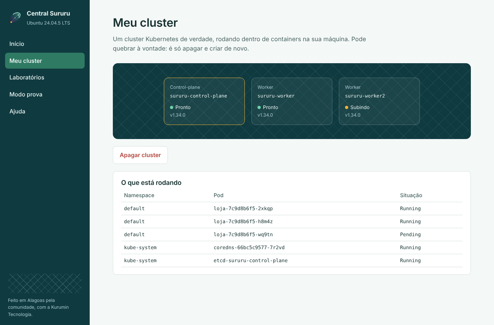

# Seu primeiro cluster

## Pela Central (o jeito fácil)

1. Abra a **Central Sururu** (ícone da concha na barra).
2. Vá em **Meu cluster**.
3. Escolha o tamanho e clique em **Criar meu cluster**.

Na primeira vez leva uns 2 minutos, porque baixa a imagem do Kubernetes. Você
acompanha tudo na tela e, no fim, vê os nós ficando **Prontos**.



| Tamanho | Memória recomendada | Bom para |
|---|---|---|
| Só o control-plane | 4 GB | Primeiros comandos, labs iniciais |
| 1 worker | 6 GB | A maioria dos laboratórios |
| 2 workers | 8 GB ou mais | Ver pods se espalhando, treinar para a CKA |

Quebrou tudo? Ótimo, é para isso que serve. Clique em **Apagar cluster** e
crie de novo.

## Pelo terminal

A Central usa o [kind](https://kind.sigs.k8s.io), que cria cada nó do cluster
como um container Docker. Você pode fazer o mesmo na mão:

```bash
kind create cluster --name sururu
kubectl get nodes
kubectl get pods -A
```

Para olhar o cluster de um jeito visual sem sair do terminal, rode `k9s`
(aperte `?` para ver os atalhos e `:q` para sair).

## Deu erro?

| Mensagem | O que fazer |
|---|---|
| `permission denied ... docker.sock` | Seu usuário não está no grupo docker: `sudo usermod -aG docker $USER`, saia da sessão e entre de novo |
| `Cannot connect to the Docker daemon` | O Docker está parado: `sudo systemctl start docker` |
| Fica parado em `Ensuring node image` | É o download da imagem (~500 MB). Confira a internet e espere |
| Nós ficam em `NotReady` | Pouca memória. Apague e crie só com o control-plane |
